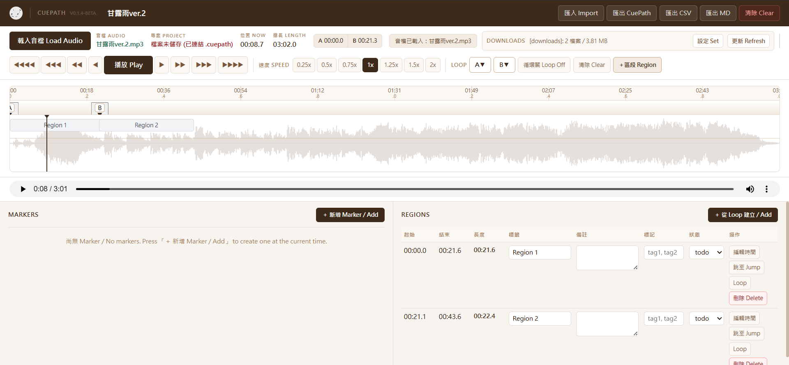

# CuePath — v0.2.1-BETA
[繁體中文版](./README.zh-Hant.md)



CuePath is a lightweight player designed specifically for music transcription and audio reference marking.

> **BETA Notes:**
> - Current version: v0.2.1-BETA (player core extracted into an embeddable ES module; the standalone app is unchanged for users).
> - **Professional Saving:** Once a `.cuepath` file is saved/linked, `Ctrl+S` performs a silent overwrite using the File System Access API.
> - **Smart Markers:** Markers now use a dynamic lane system to prevent label overlap.
> - **Region Editing:** Regions can now be resized by dragging their boundaries on the timeline.
> - Tested on Windows; macOS functionality is expected but not fully verified.

The core tool is a single file `CuePath.html`, which can be opened directly in a browser without the need for a server, Node.js, React, PHP, databases, or external packages. (Node.js is only needed if you want to rebuild it from `src/`, see below.)

## Files

- `CuePath.html`: Main player and marking tool, containing HTML, CSS, and JavaScript. Generated from `src/` by `npm run build`.
- `src/`, `dist/`, `docs/`, `test/`: Reusable player core (ES module + CSS), its built artifacts, the peaks format spec, and the tests.
- `downloads/`: Suggested directory for downloaded or exported audio files.
- `assets/`, `fonts/`: Local assets and legacy fonts used by the interface.
- `YTDL-Helper.bat`: Standalone Windows helper for downloading YouTube audio with `yt-dlp` and `ffmpeg`.

## Usage

1. Open `CuePath.html` directly in Chrome, Edge, Brave, or Firefox.
2. Click `Load Audio` to select a local audio file.
3. For new projects, the project name will default to the file name.
4. Click anywhere on the timeline to seek.
5. Use Markers, Regions, and A/B Loop for transcription and marking.
6. Use `Export CuePath` to save/link a `.cuepath` project file; use `Import` to restore data.
7. Once linked, use `Ctrl+S` to save changes silently.

## Features

### Audio Playback
- Native browser `<audio>` playback for local files.
- Supports `audio/*` formats depending on browser capabilities.
- Play/Pause and Seek to Start.
- Fast Forward/Rewind: 1s, 3s, 5s, 10s.
- Playback Speed: 0.25x to 2x.

### Timeline
- Full-width timeline for precise alignment.
- Time scale display.
- Click-to-seek support.
- Draggable current position cursor/playhead.
- Waveform visualization using Web Audio API and Canvas.

### A/B Loop
- Supports Set A and Set B.
- Integrated A/B time display within the Loop control group.
- Draggable A/B markers on the timeline.
- Auto-looping logic: jumps back to A when reaching B.
- Create Region from the current A/B Loop.

### Markers
- Add markers at the current playback time.
- **Smart Lanes:** Automatic multi-layer layout to prevent label overlap.
- **Density Control:** Labels automatically hide in crowded areas, showing on hover.
- Features: Edit label/note/tags, status selection, seek, delete, and drag-to-adjust time.

### Regions
- Create regions from A/B Loops.
- **Boundary Dragging:** Resize start/end times directly on the timeline.
- **Table Time Editing:** Edit timecodes directly within the regions table.
- Features: Edit label/note/tags, status selection, seek, delete, and one-click loop activation.

### Import / Export / Saving
- **Professional Save:** Support for persistent file handles; silent overwrite on `Ctrl+S`.
- Export project file (`.cuepath` JSON).
- Import support: `.cuepath`, `.cuepath.json`, `.json`.
- Export to CSV and Markdown tables.

### Storage
- Auto-saves project state to `localStorage`.
- Syncs `isDirty` state with the document title (`*` indicator) and status bar.

### Downloads / Folder API
- Support for File System Access API (Chromium-based browsers).
- **Brave Support:** Guidance for `brave://flags` and specialized re-authorization logic.
- Set a downloads folder to scan for files and auto-reload audio/projects.

## Building and embedding (v0.2.0)

The player is now a reusable ES module (`src/cuepath-core.js` + `src/cuepath-core.css`); the standalone
`CuePath.html` is generated from it. **The committed `CuePath.html` is a single self-contained file and still
works by double-click from disk (`file://`)** - the bundle is inlined as a classic script, because Chrome
refuses to load ES modules over `file://`.

```
npm install        # esbuild (build) + puppeteer-core (tests only)
npm run build      # -> CuePath.html, dist/cuepath-core.mjs, dist/cuepath-core.css
npm test           # headless Chrome/Edge: standalone over file:// + test/url-load.html over http
```

Do not edit `CuePath.html` by hand; edit `src/` and rebuild. The runtime of the standalone file has no dependencies.

### Embedding in another web app (e.g. a React component)

Vendor `dist/cuepath-core.mjs` and `dist/cuepath-core.css`, then:

```js
import { createCuePath } from "./vendor/cuepath-core.mjs";
import "./vendor/cuepath-core.css";           // all rules are scoped under .cuepath-root

const cp = createCuePath(containerElement, {
  storageKey: "hub:" + audioId,               // localStorage key (default "cuepath:html:mvp"; false = no persistence)
  crossOrigin: null,                          // "anonymous" | "use-credentials" | null for the <audio> element
  labels: { play: "Play", pause: "Pause" },   // override any UI text, see DEFAULT_LABELS in the source
});
await cp.loadUrl("/api/audio/42/stream", {
  peaksUrl: "/api/audio/42/peaks.json",       // or peaks: {...}; docs/peaks-format.md
  title: "Demo mix.wav",
  fetchOptions: { credentials: "include" },   // used for the peaks fetch (and the decode fallback)
});
cp.on("change", state => save(state));
// React cleanup
return () => cp.destroy();
```

API: `loadFile(file)`, `loadUrl(url, { peaksUrl?, peaks?, title?, fetchOptions?, crossOrigin? })`, `loadPeaks(json)`,
`getState()` / `setState(state)`, `clearProject()` (resets markers, regions, loop, title and audio exactly like the Clear button, but **never shows a confirm dialog** - the host app is responsible for confirming; it emits `change`), `on(event, cb)` (returns an unsubscribe function) / `off`, `play()`, `pause()`,
`seek(s)`, `setPlaybackRate(r)`, `getAudioElement()`, `toCsv()`, `toMarkdown()`, `exportProject()`, `destroy()`.
Events: `ready`, `peaks`, `change`, `timeupdate`, `play`, `pause`, `message`, `error`, `save-request` (Ctrl+S; if nobody listens, a `.cuepath` file is saved).
`loadUrl` streams through `<audio src>` and never decodes the file when peaks are supplied; without peaks it falls back to
decoding the whole file. `destroy()` removes every listener, animation frame, in-flight fetch and AudioContext. A
`loadUrl()` still pending at `destroy()` rejects with `Error("destroyed")`.

Options for a host app that wants more or less UI: `ui: { toolbar, headerActions, loadButton, downloads }` (`headerActions: false` hides the import / export CuePath / export CSV / export Markdown / clear buttons; default `true`), `shortcuts` / `dragDrop`
(`"root"` by default, `"document"`, or `false`), `header: { logoSrc, logoAlt, tag, version }`. The `standalone: true` flag
(used by `CuePath.html`) turns on the app-level behaviour: save/replace dialogs, unload guard, downloads folder, document-wide
shortcuts and drop target. Peaks format: [docs/peaks-format.md](./docs/peaks-format.md).

## YouTube Audio Helper

`YTDL-Helper.bat` is a standalone Windows helper for downloading YouTube audio files.

- Checks for `yt-dlp` and `ffmpeg`.
- Provides an interactive menu for entering a YouTube URL and downloading audio.
- Downloaded files can be placed in `downloads/` and loaded into CuePath.
- This helper is separate from the core CuePath app; CuePath still works offline with local audio files.

## Shortcuts

- `Ctrl + S`: Save project (Silent overwrite if linked, otherwise Save As)
- `Space`: Play / Pause
- `ArrowLeft / Right`: Jump 3s (add `Shift` for 10s, `Alt` for 1s)
- `Home`: Seek to start
- `A / B`: Set Loop A / B
- `L`: Toggle Loop On / Off
- `M`: Add Marker

## Browser Compatibility

- Windows (Fully tested)
- macOS (Core functionality expected to work)
- Chrome / Edge / Brave (Recommended)
- Firefox (Supported, but lacks Folder API)
