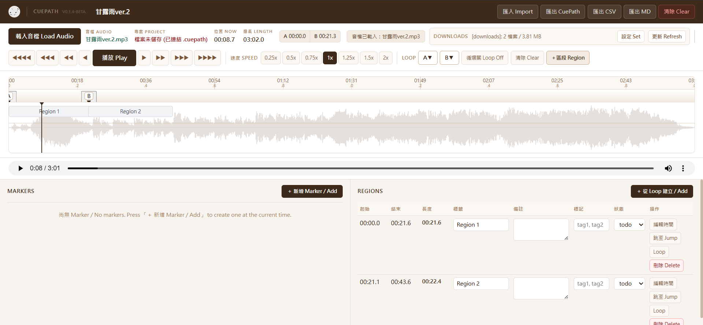

# CuePath — v0.2.1-BETA

[English Version](./README.md)




CuePath 是一個專為音樂採譜與參考音檔標記設計的輕量級播放器。

> **BETA 測試說明：**
> - 目前版本為 v0.2.1-BETA（播放器核心抽成可嵌入的 ES module；獨立版對使用者沒有改變）。
> - **專業儲存體驗**：實裝 File System Access API，一旦連結檔案後，`Ctrl+S` 將直接覆寫存檔而不彈出視窗。
> - **智能標記系統**：Marker 實裝智能避讓軌道，解決標籤重疊問題。
> - **區段邊界拖曳**：支援直接在時間軸上拖曳 Region 的左右邊界以調整時間。
> - 已在 Windows 環境測試正常，macOS 尚未經過完整測試。

核心工具是單一檔案 `CuePath.html`，可直接用瀏覽器開啟，不需要伺服器、Node、React、PHP、資料庫或外部套件。

## 目前檔案

- `CuePath.html`：主要播放器與標記工具，包含 HTML、CSS、JavaScript（由 `src/` 以 `npm run build` 產生）。
- `src/`、`dist/`、`docs/`、`test/`：可重用的播放器核心（ES module + CSS）、建置產物、peaks 格式規格與測試。
- `downloads/`：建議放置下載或轉出的音檔。
- `assets/`、`fonts/`：目前介面使用的本機素材與字型。
- `YTDL-Helper.bat`：獨立 Windows 小工具，用於透過 `yt-dlp` 與 `ffmpeg` 下載 YouTube 音檔。

## 使用方式

1. 直接雙擊 `CuePath.html`，或用 Chrome / Edge / Brave / Firefox 開啟。
2. 按 `載入音檔 Load Audio` 選擇本機音檔。
3. 第一次載入新專案時，會以音檔名稱作為預設值。
4. 在 timeline 上點擊可跳到指定時間。
5. 使用 Marker、Region、A/B Loop 進行採譜標記。
6. 用 `匯出 CuePath` 儲存並連結 `.cuepath` 專案檔；連結後可使用 `Ctrl+S` 靜默存檔。

## 已實作功能

### 音檔播放

- 使用瀏覽器原生 `<audio>` 播放本機音檔。
- 支援 `audio/*`，實際可播放格式依瀏覽器能力而定。
- 可播放 / 暫停。
- 可跳回開頭。
- 支援快退 / 快進：1 秒、3 秒、5 秒、10 秒。
- 支援播放速度：0.25x 到 2x。

### Timeline

- 全寬 timeline，方便採譜時對齊時間比例。
- 顯示時間刻度與點擊跳轉。
- 目前播放位置的 cursor / playhead 可拖曳。
- 顯示音波圖（使用 Web Audio API 解碼並以 Canvas 繪製）。

### A/B Loop

- 支援 Set A、Set B 與獨立 Loop Bar。
- **資訊整合**：A/B 點時間直接顯示在 Loop 控制區塊中。
- 標記點可在時間軸上直接拖曳調整。
- 循環模式開啟時，播放到 B 會自動跳回 A。
- 可從目前 A/B Loop 建立 Region。

### Marker (標記點)

- 可在目前播放時間新增 Marker。
- **智能避讓軌道**：標籤自動分層排列，避免重疊。
- **密集度控制**：極度擁擠時自動隱藏標籤文字，Hover 時顯示。
- 支援編輯標題、筆記、標籤、狀態選擇、跳轉、刪除與拖曳調整時間。

### Region (區段)

- 可由 A/B Loop 建立 Region。
- **邊界拖曳**：直接在 Timeline 拖曳左右邊緣即可縮放區段。
- **表格時間編輯**：可在 Region 表格中直接輸入編輯開始與結束時間。
- 支援編輯標題、筆記、標籤、狀態選擇、跳轉、刪除與一鍵啟用循環。

### 儲存與同步

- **專業儲存**：支援 File System Access API 進行持久化存檔。
- **狀態同步**：`isDirty` 狀態精確連動標題 `*` 號與狀態列顯示。
- 支援匯出 CSV 與 Markdown 表格。

### 拖曳檔案

- 支援拖入音檔、專案檔，或同時拖入兩者以自動載入。

### localStorage

- 自動儲存專案狀態（不含音檔本體）至瀏覽器 localStorage。

### Downloads / Folder API

- 支援瀏覽器 File System Access API。
- **Brave 專屬引導**：針對 Brave 權限失效提供引導語與「重新授權」按鈕。
- 可設定下載資料夾以自動掃描與重新載入音檔。

## 建置與嵌入（v0.2.0）

播放器核心已抽成可重用的 ES module（`src/cuepath-core.js` + `src/cuepath-core.css`），獨立版 `CuePath.html` 由它產生。
**已提交的 `CuePath.html` 仍是單一、自給自足的檔案，直接雙擊從磁碟開啟（`file://`）即可使用**——打包後的程式以一般 script 內嵌，
因為 Chrome 不允許在 `file://` 載入 ES module。

```
npm install        # esbuild（建置）+ puppeteer-core（僅測試用）
npm run build      # -> CuePath.html、dist/cuepath-core.mjs、dist/cuepath-core.css
npm test           # 無頭 Chrome/Edge：file:// 開啟獨立版 + http 執行 test/url-load.html
```

請勿手動編輯 `CuePath.html`；修改 `src/` 後重新建置。獨立版執行時沒有任何相依套件（Node 只在重新建置時需要）。

### 嵌入其他網頁應用（例如 React 元件）

把 `dist/cuepath-core.mjs` 與 `dist/cuepath-core.css` 放進你的專案：

```js
import { createCuePath } from "./vendor/cuepath-core.mjs";
import "./vendor/cuepath-core.css";           // 所有樣式都限定在 .cuepath-root 之下，不會污染宿主頁面

const cp = createCuePath(containerElement, {
  storageKey: "hub:" + audioId,               // localStorage key（預設 "cuepath:html:mvp"；false 表示不儲存）
  crossOrigin: null,                          // <audio> 的 crossorigin："anonymous" | "use-credentials" | null
  labels: { play: "Play", pause: "Pause" },   // 覆寫任何介面文字，見原始碼 DEFAULT_LABELS
});
await cp.loadUrl("/api/audio/42/stream", {
  peaksUrl: "/api/audio/42/peaks.json",       // 或 peaks: {...}；格式見 docs/peaks-format.md
  title: "Demo mix.wav",
  fetchOptions: { credentials: "include" },   // 用於取得 peaks（以及無 peaks 時的解碼備援）
});
cp.on("change", state => save(state));
// React cleanup
return () => cp.destroy();
```

API：`loadFile(file)`、`loadUrl(url, { peaksUrl?, peaks?, title?, fetchOptions?, crossOrigin? })`、`loadPeaks(json)`、
`getState()` / `setState(state)`、`on(event, cb)`（回傳取消訂閱函式）/ `off`、`play()`、`pause()`、`seek(s)`、
`setPlaybackRate(r)`、`getAudioElement()`、`toCsv()`、`toMarkdown()`、`exportProject()`、`destroy()`。
事件：`ready`、`peaks`、`change`、`timeupdate`、`play`、`pause`、`message`、`error`、`save-request`（Ctrl+S；沒人監聽時會儲存 `.cuepath` 檔）。
`loadUrl` 以 `<audio src>` 串流播放；有提供 peaks 時**不會**下載或解碼整個檔案；沒有 peaks 時退回整檔解碼。
`destroy()` 會移除所有事件監聽、動畫幀、進行中的 fetch 與 AudioContext；`destroy()` 時仍在進行的 `loadUrl()` 會以 `Error("destroyed")` reject。

想調整介面的宿主可用 `ui: { toolbar, headerActions, loadButton, downloads }`（`headerActions: false` 隱藏匯入／匯出 CuePath／匯出 CSV／匯出 Markdown／清除按鈕；預設 `true`）、`shortcuts` / `dragDrop`（預設 `"root"`，可設 `"document"` 或 `false`）、
`header: { logoSrc, logoAlt, tag, version }`。`standalone: true`（`CuePath.html` 使用）會啟用應用層行為：儲存/取代對話框、離開頁面警告、
downloads 資料夾、全頁快捷鍵與拖放。Peaks 格式：[docs/peaks-format.md](./docs/peaks-format.md)。

## YouTube 音檔下載小工具

`YTDL-Helper.bat` 是獨立 Windows 小工具，用來協助下載 YouTube 音檔。

- 會檢查 `yt-dlp` 與 `ffmpeg`。
- 提供互動式選單，可輸入 YouTube 網址並下載音檔。
- 下載結果可放入 `downloads/`，再由 CuePath 載入。
- 這個工具與 CuePath 主程式分離；CuePath 仍可完全離線處理本機音檔。

## 快捷鍵

- `Ctrl + S`：儲存專案 (已連結時為靜默存檔，未連結時為另存新檔)
- `Space`：播放 / 暫停
- `ArrowLeft / Right`：跳轉 3 秒 (加 `Shift` 跳轉 10 秒, 加 `Alt` 跳轉 1 秒)
- `Home`：回到開頭
- `A / B`：設定 A / B 循環點
- `L`：循環開關
- `M`：新增 Marker

## 瀏覽器與平台

- Windows (完整測試)
- macOS (核心功能應可運行)
- Chrome / Edge / Brave (建議使用)
- Firefox (支援，但無 Folder API)
